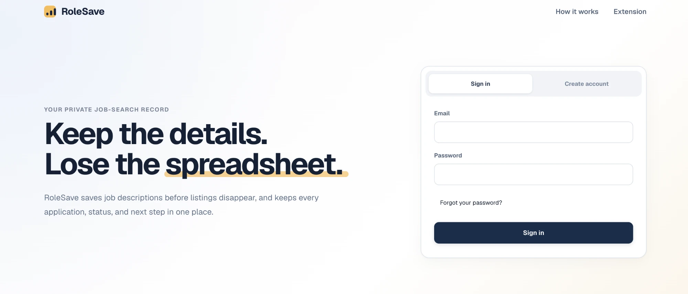
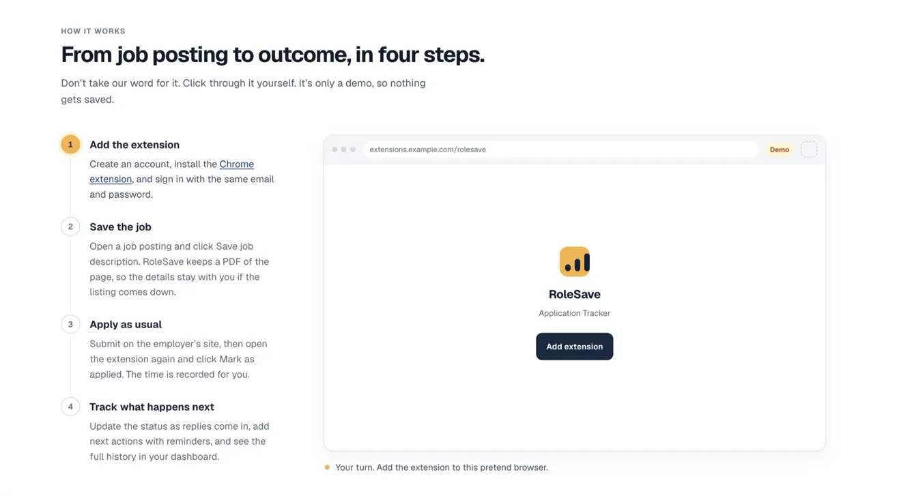
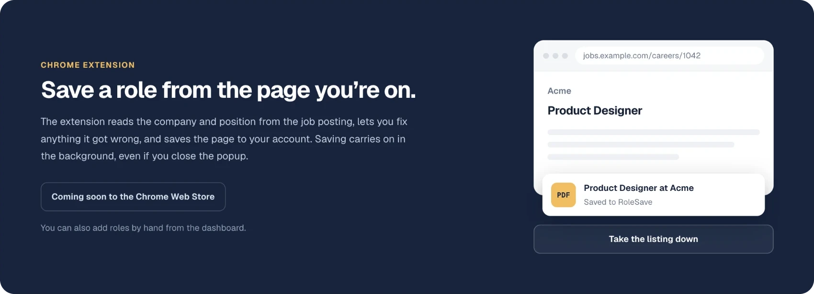

# RoleSave

**Keep the details. Lose the spreadsheet.**

RoleSave is a private job-application tracker. It saves job descriptions before
listings disappear, and keeps every application, status, and next step in one place.

Save a job description from the browser, mark the role as applied, and update its
status yourself as confirmations, assessments, interviews, rejections, or offers
arrive.



## Contents

- [What RoleSave does](#what-rolesave-does)
- [How it works](#how-it-works)
- [Chrome extension](#chrome-extension)
- [Project structure](#project-structure)
- [Technology](#technology)
- [Getting started](#getting-started)
- [Common commands](#common-commands)
- [Documentation](#documentation)
- [Status](#status)
- [Privacy](#privacy)

## What RoleSave does

- Saves job descriptions before listings disappear.
- Records applications from the Chrome extension or manual entry.
- Lets you mark each saved role as Pursue, Maybe, or Pass.
- Tracks dated next actions and shows due or overdue reminders inside the dashboard.
- Shows application status and evidence in a private web dashboard.
- Optionally stores PDFs or DOCX files you upload for a role.
- Preserves a chronological history for every application.

RoleSave is focused on tracking. It does not submit applications, score resumes,
write cover letters, or recommend jobs.

## How it works



1. **Add the extension.** Create an account, install the Chrome extension, and sign in
   with the same email and password.
2. **Save the job.** Open a job posting and click **Save job description**. The
   extension captures the page, and the background worker converts it into a PDF in an
   isolated container, so the original listing is preserved even after it goes offline.
3. **Apply as usual.** Submit on the employer's site, then open the extension again and
   click **Mark as applied**. The time is recorded for you.
4. **Track what happens next.** Update the status as replies come in, add next actions
   with reminders, and see each role's decision and full history in the dashboard.

Saving a posting you already track reuses its existing record. If a duplicate slips
through, you can merge it from the application page.

A capture that fails automatic processing can be retried from its application page or
from the Processing issues page at `/dashboard/operations`.

Reminders are in-app only. They appear while the dashboard is open or the next
time you visit; RoleSave does not send email or browser notifications.
Actions for roles marked Pass are paused until you change that decision.

## Chrome extension



The extension reads the company and position from the job posting, lets you fix
anything it got wrong, and saves the page to your account. Saving carries on in the
background, even if you close the popup. You can also add roles by hand from the
dashboard.

The extension is coming soon to the Chrome Web Store. Until then, build it and load it
unpacked, as described in [Getting started](#getting-started).

## Project structure

```text
apps/
  extension/   Chrome extension for saving roles and capturing job pages
  web/         Next.js landing page, dashboard, and authentication
  worker/      Background worker that converts captured pages into PDFs
packages/
  config/      Shared configuration
  types/       Shared TypeScript types
  validation/  Shared input validation
supabase/      Local configuration, migrations, email templates, tests, and seed data
spikes/        Technical experiments, including the PDF converter's Docker image
scripts/       SQL test runner
docs/          Local development guide, reference documentation, and README media
```

## Technology

- TypeScript monorepo managed with pnpm
- Next.js and React for the web application
- React and Vite for the Manifest V3 Chrome extension
- Supabase for authentication, PostgreSQL, and private file storage
- Chromium in a disposable, networkless Docker or Podman container for PDF conversion

## Getting started

### Prerequisites

- Node.js 24 (the version CI uses)
- pnpm 11.19 or newer
- A Docker-compatible runtime for local Supabase and isolated PDF conversion
- Chrome 116 or newer for the extension

Install dependencies:

```sh
pnpm install
pnpm mhtml:image:build
```

Start the local Supabase stack:

```sh
pnpm supabase:start
pnpm supabase:status
```

Copy the example environment configuration:

```sh
cp .env.example apps/web/.env.local
```

Replace the placeholders in `apps/web/.env.local` with the local values printed by
Supabase. Keep `SUPABASE_SECRET_KEY` on the server only.

Start the web application and the background worker together:

```sh
pnpm dev
```

Then open [http://127.0.0.1:3100](http://127.0.0.1:3100). The worker turns saved job pages into PDFs, so saves wait in a queue until it is running.

Build the extension to save real job pages:

```sh
pnpm --filter @rolesave/extension build:dev
```

Then open `chrome://extensions`, turn on Developer mode, click **Load unpacked**, and
choose `apps/extension/dist`. Sign in with the same account you use on the dashboard.

For detailed Supabase and local setup instructions, see
[Local development](docs/LOCAL_DEVELOPMENT.md).

## Common commands

| Command | Purpose |
| --- | --- |
| `pnpm dev` | Start the web dashboard and background worker together |
| `pnpm dev:web` | Start only the web dashboard |
| `pnpm dev:extension` | Run the extension popup on a Vite dev server |
| `pnpm --filter @rolesave/extension build:dev` | Build the extension to load unpacked in Chrome |
| `pnpm dev:worker` | Start only the background worker |
| `pnpm test` | Run the test suite |
| `pnpm test:authorization` | Run two-user database, storage, and replay isolation tests |
| `pnpm mhtml:image:build` | Build the isolated MHTML converter image |
| `pnpm typecheck` | Type-check all workspaces |
| `pnpm lint` | Run configured linters |
| `pnpm build` | Build all buildable workspaces |
| `pnpm supabase:reset` | Recreate local data from migrations and seed data |
| `pnpm test:fingerprint` | Run the fingerprint SQL tests against a disposable database |

## Documentation

- [Local development guide](docs/LOCAL_DEVELOPMENT.md)
- [Extension README](apps/extension/README.md)
- [Web app README](apps/web/README.md)

## Status

RoleSave is under active MVP development and is not ready for production use. It is
not hosted yet and the extension is not on the Chrome Web Store yet, so for now it
runs locally.

## Privacy

Application data and saved job descriptions can contain sensitive personal
information. Keep deployments private, use server-only credentials for privileged
operations, and never commit local environment files or captured job data.
